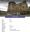

# Marion Ross
(1900 - ?)

## Immediate Family

* Brother: X
* Father: [John Hugh Ross](./@75057664@-john-hugh-ross-b1859-6-19-d1941-10-7.md) (19/Jun/1859 - 7/Oct/1941)
* Mother: [Marion Cumming](./@59851647@-marion-cumming-b1863-5-20-d1944-11-18.md) (20/May/1863 - 18/Nov/1944)
* Sister: [Ann Ross](./@52613824@-ann-ross-b1890-11-28-d1980-6-27.md) (28/Nov/1890 - 27/Jun/1980)
* Brother: [James Ross](./@62357517@-james-ross-b1893-d.md) (1893 - )
* Sister: [Jessie Ross](./@49602674@-jessie-ross-b1895-d.md) (1895 - )
* Brother: [Hugh Alexander Ross](./@22731476@-hugh-alexander-ross-b1896-11-17-d.md) (17/Nov/1896 - )
* Brother: [John Donald Ross](./@60714754@-john-donald-ross-b1900-10-29-d1917-1-26.md) (29/Oct/1900 - 26/Jan/1917)

## Timeline

Date | Item | Description | Sources | Notes
---|---|---|---|---
1900 | Born | Born to [John Hugh Ross](./@75057664@-john-hugh-ross-b1859-6-19-d1941-10-7.md) and [Marion Cumming](./@59851647@-marion-cumming-b1863-5-20-d1944-11-18.md). | [1](#1) | 
29/Oct/1900 | Birth of brother | [John Donald Ross](./@60714754@-john-donald-ross-b1900-10-29-d1917-1-26.md) born to [John Hugh Ross](./@75057664@-john-hugh-ross-b1859-6-19-d1941-10-7.md) and [Marion Cumming](./@59851647@-marion-cumming-b1863-5-20-d1944-11-18.md) in Embo, Sutherland, Scotland. | [2](#2) | 
26/Jan/1917 | Death of brother | [John Donald Ross](./@60714754@-john-donald-ross-b1900-10-29-d1917-1-26.md) died in , At Sea. | [3](#3), [4](#4), [5](#5), [6](#6) | 
1941 | Burial of father | [John Hugh Ross](./@75057664@-john-hugh-ross-b1859-6-19-d1941-10-7.md) was buried in Dornoch Free Church Cemetery, Dornoch, Sutherland, Scotland. | [7](#7) | 
7/Oct/1941 | Death of father | [John Hugh Ross](./@75057664@-john-hugh-ross-b1859-6-19-d1941-10-7.md) died in Embo, Sutherland, Scotland. | [7](#7), [8](#8) | 
1944 | Burial of mother | [Marion Cumming](./@59851647@-marion-cumming-b1863-5-20-d1944-11-18.md) was buried in Dornoch Free Church Cemetery, Dornoch, Sutherland, Scotland. | [7](#7) | 
18/Nov/1944 | Death of mother | [Marion Cumming](./@59851647@-marion-cumming-b1863-5-20-d1944-11-18.md) died in Embo, Sutherland, Scotland. | [7](#7), [9](#9), [10](#10) | 
27/Jun/1980 | Death of sister | [Ann Ross](./@52613824@-ann-ross-b1890-11-28-d1980-6-27.md) died in Clear Lake Hospital, Harris County, Texas, United States of America. | [11](#11) | 

## Known Residences

Date | Residence | Sources & Notes
---|---|---
1901 | 1 Front Street, Embo, Sutherland, Scotland | [1](#1)

## Footnotes

### 1

**1901 ROSS, JOHN + HOUSEHOLD (Census 047/ 2/ 22)**

* [Full text and notes](../sources/@45903628@-1901-ross,-john-+-household-census-047-2-22-.md)
* Date: 1901
* Responsible Agency: National Records of Scotland
* References: 
  * 1901 C 047/ 2/ 22

### 2

**1900 ROSS, JOHN DONALD (Statutory Register of Births 047/ 50)**

* [Full text and notes](../sources/@97516544@-1900-ross,-john-donald-statutory-register-of-births-047-50-.md)
* Date: 3/Nov/1900
* Responsible Agency: National Registers of Scotland
* References: 
  * 1900 B 047/ 50

### 3

**1917 ROSS, DONALD JOHN (Register of the Mercantile Marine Memorial)**

* [Full text and notes](../sources/@75198717@-1917-ross,-donald-john-register-of-the-mercantile-marine-memorial-.md)
* Publication: Register of the Mercantile Marine Memorial, Part Seven
* Originator / Author: Imperial War Graves Commission
* Date: 1928

### 4

**1917 ROSS, JOHN D (Register of Deceased Seamen 1917)**

* [Full text and notes](../sources/@28339740@-1917-ross,-john-d-register-of-deceased-seamen-1917-.md)

### 5

**1917 ROSS, JOHN DONALD (Scottish National War Memorial)**

* [Full text and notes](../sources/@79376054@-1917-ross,-john-donald-scottish-national-war-memorial-.md)
* References: 
  * (URL) https://www.snwm.org/roll-search
* 

### 6

**1917 ROSS, JOHN DONALD Cadet (Find a Grave)**

* [Full text and notes](../sources/@61547438@-1917-ross,-john-donald-cadet-find-a-grave-.md)
* References: 
  * (URL) https://www.findagrave.com/memorial/15371569/john-donald-ross

### 7

**1944 ROSS, JOHN HUGH & MARION (Find A Grave)**

* [Full text and notes](../sources/@8128891@-1944-ross,-john-hugh-&-marion-find-a-grave-.md)
* Publication: FindAGrave.com
* References: 
  * (URL) https://www.findagrave.com/memorial/195246893/marion-ross

### 8

**1941 X, JOHN HUGH (Statutory Register of Deaths 047/ 41)**

* [Full text and notes](../sources/@40303624@-1941-ross,-john-hugh-statutory-register-of-deaths-047-41-.md)
* Date: 8/Oct/1941
* Responsible Agency: National Records of Scotland
* References: 
  * 1941 D 047/ 41

### 9

**1944 ROSS, MARION (Statutory Register of Deaths 047/ 30)**

* [Full text and notes](../sources/@2243749@-1944-ross,-marion-statutory-register-of-deaths-047-30-.md)
* Responsible Agency: National Records of Scotland
* References: 
  * 1944 D 047/ 30

### 10

**P161 Embo - genealogy, Uncle Sandy's Story and a little history**

* [Full text and notes](../sources/@95058656@-p161-embo-genealogy,-uncle-sandy's-story-and-a-little-history.md)
* Publication: Embo - genealogy, Uncle Sandy's Story and a little history
* Originator / Author: Catriona Grigg
* Date: 2016
* Filed by Entry: EMBO/P161/C1.3
* References: 
  * (ISBN) 978-1-910205-49-5

### 11

**1980 MITCHELL, ANN (Texas, U.S., Death Certificates, 1903-1982)**

* [Full text and notes](../sources/@54706080@-1980-mitchell,-ann-texas,-u.s.,-death-certificates,-1903-1982-.md)
* Publication: Texas, U.S., Death Certificates, 1903-1982
* Responsible Agency: Texas Department of State Health Services; Austin Texas, USA
* References: 
  * (State File Number) 55415

