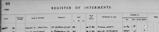
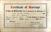

# Kenneth Mackay
(2 February, 1895 - ?)

## Immediate Family

* Mother: [Isabella Mackay](./@32797554@-isabella-mackay-b1860-8-7-d1936-4-23.md) (7/Aug/1860 - 23/Apr/1936)
* Father: [James Mackay](./@60572122@-james-mackay-b1861-4-12-d1903-7-6.md) (12/Apr/1861 - 6/Jul/1903)
* Sister: [Lucy Mackay](./@16587624@-lucy-mackay-b1889-9-23-d1970-5-15.md) (23/Sep/1889 - 15/May/1970)
* Brother: [George Mackay](./@72941728@-george-mackay-b1890-11-12-d.md) (12/Nov/1890 - )
* Sister: [Janet Mackay](./@22499038@-janet-mackay-b1890-11-12-d1891-5-15.md) (12/Nov/1890 - 15/May/1891)
* Sister: [Annie Mackay](./@51252926@-annie-mackay-b1892-12-15-d1918.md) (15/Dec/1892 - 1918)
* Brother: [John Paul Mackay](./@57646474@-john-paul-mackay-b1899-3-13-d1969-7-3.md) (13/Mar/1899 - 3/Jul/1969)
* Wife: [Helen Morrison](./@62432280@-helen-morrison-b1900-1-5-d1984-12-28.md) (5/Jan/1900 - 28/Dec/1984)
* Brother: [William Alexander Mackay](./@9383584@-william-alexander-mackay-b1900-2-24-d1982-9-24.md) (24/Feb/1900 - 24/Sep/1982)
* Sister: [Margaret Moyes Mackay](./@178005@-margaret-moyes-mackay-b1901-6-27-d1973-8-24.md) (27/Jun/1901 - 24/Aug/1973)
* Son: X
* Daughter: X

## Timeline

Date | Item | Description | Sources | Notes
---|---|---|---|---
2/Feb/1895 | Born | Born to [James Mackay](./@60572122@-james-mackay-b1861-4-12-d1903-7-6.md) and [Isabella Mackay](./@32797554@-isabella-mackay-b1860-8-7-d1936-4-23.md) in Embo, Sutherland, Scotland. | [1](#1), [2](#2) | [3](#3)
13/Mar/1899 | Birth of brother | [John Paul Mackay](./@57646474@-john-paul-mackay-b1899-3-13-d1969-7-3.md) born to [James Mackay](./@60572122@-james-mackay-b1861-4-12-d1903-7-6.md) and [Isabella Mackay](./@32797554@-isabella-mackay-b1860-8-7-d1936-4-23.md) in Embo, Sutherland, Scotland. | [2](#2), [4](#4) | 
24/Feb/1900 | Birth of brother | [William Alexander Mackay](./@9383584@-william-alexander-mackay-b1900-2-24-d1982-9-24.md) born to [James Mackay](./@60572122@-james-mackay-b1861-4-12-d1903-7-6.md) and [Isabella Mackay](./@32797554@-isabella-mackay-b1860-8-7-d1936-4-23.md) in Embo, Sutherland, Scotland. | [2](#2), [5](#5), [6](#6), [7](#7) | 
27/Jun/1901 | Birth of sister | [Margaret Moyes Mackay](./@178005@-margaret-moyes-mackay-b1901-6-27-d1973-8-24.md) born to [James Mackay](./@60572122@-james-mackay-b1861-4-12-d1903-7-6.md) and [Isabella Mackay](./@32797554@-isabella-mackay-b1860-8-7-d1936-4-23.md) in Embo, Sutherland, Scotland. | [2](#2), [8](#8) | 
6/Jul/1903 | Death of father | [James Mackay](./@60572122@-james-mackay-b1861-4-12-d1903-7-6.md) died. | [9](#9) | 
1918 | Death of sister | [Annie Mackay](./@51252926@-annie-mackay-b1892-12-15-d1918.md) died. | [2](#2) | [10](#10)
15/Mar/1923 | Immigrated | Immigrated to Toronto, York, Ontario, Canada. | [11](#11) | 
28/Oct/1926 | Marriage | Married to [Helen Morrison](./@62432280@-helen-morrison-b1900-1-5-d1984-12-28.md) in Detroit, Michigan, United States of America | [12](#12) | 
about 1928 | Birth of son | X born to [Kenneth Mackay](./@48909111@-kenneth-mackay-b1895-2-2-d.md) and [Helen Morrison](./@62432280@-helen-morrison-b1900-1-5-d1984-12-28.md). | [13](#13) | 
after 1931 | Birth of daughter | X born to [Kenneth Mackay](./@48909111@-kenneth-mackay-b1895-2-2-d.md) and [Helen Morrison](./@62432280@-helen-morrison-b1900-1-5-d1984-12-28.md). |  | 
1/Jun/1931 | Census | Census | [13](#13) | 
23/Apr/1936 | Death of mother | [Isabella Mackay](./@32797554@-isabella-mackay-b1860-8-7-d1936-4-23.md) died in Embo, Sutherland, Scotland. | [11](#11), [14](#14), [15](#15) | 
1969 | Burial of brother | [John Paul Mackay](./@57646474@-john-paul-mackay-b1899-3-13-d1969-7-3.md) was buried in Dornoch Free Church Cemetery, Dornoch, Sutherland, Scotland. | [16](#16) | 
3/Jul/1969 | Death of brother | [John Paul Mackay](./@57646474@-john-paul-mackay-b1899-3-13-d1969-7-3.md) died in Embo, Sutherland, Scotland. | [16](#16), [17](#17) | 
15/May/1970 | Death of sister | [Lucy Mackay](./@16587624@-lucy-mackay-b1889-9-23-d1970-5-15.md) died in Inverness, Scotland. | [18](#18) | 
24/Aug/1973 | Death of sister | [Margaret Moyes Mackay](./@178005@-margaret-moyes-mackay-b1901-6-27-d1973-8-24.md) died in Inverness, Highland, Scotland, . | [19](#19) | 
24/Sep/1982 | Death of brother | [William Alexander Mackay](./@9383584@-william-alexander-mackay-b1900-2-24-d1982-9-24.md) died in Glasgow, Scotland. | [20](#20), [21](#21), [22](#22) | 
30/Sep/1982 | Burial of brother | [William Alexander Mackay](./@9383584@-william-alexander-mackay-b1900-2-24-d1982-9-24.md) was buried in Glasgow, Scotland, . | [20](#20), [23](#23) | 
28/Dec/1984 | Death of partner | [Helen Morrison](./@62432280@-helen-morrison-b1900-1-5-d1984-12-28.md) died in Toronto, York, Ontario, Canada. | [24](#24) | 
1985 | Burial of partner | [Helen Morrison](./@62432280@-helen-morrison-b1900-1-5-d1984-12-28.md) was buried in Toronto, York, Ontario, Canada. | [24](#24), [25](#25) | 

## Known Residences

Date | Residence | Sources & Notes
---|---|---
1901 | 6 Terrace Street, Embo, Dornoch, Sutherland, Scotland | [26](#26)
1911 | 6 Terrace Street, Embo, Sutherlandshire | [27](#27)
1923 | 2041 Dundas Street, West Toronto, Ontario, Canada | [11](#11)
1926 | Detroit, Michigan, United States of America | [12](#12)
1930 | 146 King Edward Avenue, Toronto, Ontario, Canada | [28](#28), [29](#29)
1931 | 146 King Edward Avenue, Toronto, Ontario, Canada | [13](#13)

## Known Occupations

Date | Occupation | Sources & Notes
---|---|---
1911 | Fisherman | [27](#27)
before 1923 | Fisherman | [11](#11)
1926 | Mechanic | [12](#12)
1931 | Receiver | [13](#13)

## Footnotes

### 1

**1895 MACKAY, KENNETH (Statutory Registers Births 047/9)**

* [Full text and notes](../sources/@24683442@-1895-mackay,-kenneth-statutory-registers-births-047-9-.md)
* Date: 5/Feb/1895
* Responsible Agency: National Records of Scotland
* References: 
  * 1895 B 047/9

### 2

**P116 Embo - genealogy, Uncle Sandy's Story and a little history**

* [Full text and notes](../sources/@26144122@-p116-embo-genealogy,-uncle-sandy's-story-and-a-little-history.md)
* Publication: Embo - genealogy, Uncle Sandy's Story and a little history
* Originator / Author: Catriona Grigg
* Date: 2016
* Filed by Entry: EMBO/P116/F9.2.11
* References: 
  * (ISBN) 978-1-910205-49-5

### 3

### 4

**1899 MACKAY, JOHN PAUL (Statutory registers Births 047/19)**

* [Full text and notes](../sources/@3169273@-1899-mackay,-john-paul-statutory-registers-births-047-19-.md)
* Date: 17/Mar/1899
* Responsible Agency: National Records of Scotland
* References: 
  * 1899 B 047/19

### 5

**1900 MACKAY, WILLIAM ALEXANDER (Statutory registers Births 047/8)**

* [Full text and notes](../sources/@72028925@-1900-mackay,-william-alexander-statutory-registers-births-047-8-.md)
* Date: 12/Mar/1900
* Responsible Agency: National Registers of Scotland
* References: 
  * (Statutory Register Births) 1900 047/8

### 6

**1919 MACKAY, WILLIAM ALEXANDER - Service in Royal Navy 1/2**

* [Full text and notes](../sources/@74193018@-1919-mackay,-william-alexander-service-in-royal-navy-1-2.md)
* Responsible Agency: The National Archives
* References: 
  * BT 377/7/9475 (page 1 of 2)

### 7

**1979 MACKAY, WILLIAM ALEXANDER (Passport)**

* [Full text and notes](../sources/@20366636@-1979-mackay,-william-alexander-passport-.md)
* Date: 7/Feb/1979
* Responsible Agency: Passport Office
* References: 
  * (Passport Number) G102330A

### 8

**1901 MACKAY, MARGARET MOYES Statutory registers Births**

* [Full text and notes](../sources/@52738092@-1901-mackay,-margaret-moyes-statutory-registers-births.md)
* Date: 12/Jul/1901
* Responsible Agency: National Records of Scotland
* References: 
  * 1901-B-047/41

### 9

**1903 MACKAY, JAMES (Statutory Register of Deaths 047/ 24)**

* [Full text and notes](../sources/@53286704@-1903-mackay,-james-statutory-register-of-deaths-047-24-.md)
* Date: 7/Jul/1903
* Responsible Agency: National Records of Scotland
* References: 
  * 1903 D 047/ 24

### 10

> Influenza
>

### 11

**1923 MACKAY, KENNETH (Canada, Ocean Arrivals (Form 30A), 1919-1927)**

* [Full text and notes](../sources/@85723388@-1923-mackay,-kenneth-canada,-ocean-arrivals-form-30a-,-1919-1927-.md)
* Publication: Canada, Ocean Arrivals (Form 30A), 1919-1927
* Date: 15/Mar/1923

### 12

**1926 MCKAY, KENNETH & MORRISON, HELEN (Marriage License, Wayne County, Michigan)**

* [Full text and notes](../sources/@19059328@-1926-mckay,-kenneth-&-morrison,-helen-marriage-license,-wayne-county,-michigan-.md)
* Date: 28/Oct/1926
* Responsible Agency: Michigan Department of Health
* References: 
  * 321058

### 13

**1931 X, KENNETH & HOUSEHOLD (1931 Seventh Census of Canada)**

* [Full text and notes](../sources/@27125352@-1931-mackay,-kenneth-&-household-1931-seventh-census-of-canada-.md)
* Date: 1/Jun/1931
* Responsible Agency: Dominion Bureau of Statistics

### 14

**1919 MACKAY, LUCY Statutory Registers Marriages 644/18 240**

* [Full text and notes](../sources/@28195272@-1919-mackay,-lucy-statutory-registers-marriages-644-18-240.md)
* Responsible Agency: National Records of Scotland
* References: 
  * 1919 M 644/18 240

### 15

**1934 MACKAY, ISABELLA (Statutory Register of Deaths 047/ 12)**

* [Full text and notes](../sources/@88161691@-1934-mackay,-isabella-statutory-register-of-deaths-047-12-.md)
* Date: 25/Apr/1936
* Responsible Agency: National Records of Scotland
* References: 
  * 1936 D 047/ 12

### 16

**1969 MACKAY, JOHN PAUL (FindAGrave.com)**

* [Full text and notes](../sources/@65120865@-1969-mackay,-john-paul-findagrave.com-.md)
* Publication: FindAGrave.com
* References: 
  * (URL) https://www.findagrave.com/memorial/263488579/john-paul-mackay

### 17

**1969 MACKAY, JOHN PAUL (Statutory registers Deaths 047/18)**

* [Full text and notes](../sources/@24508315@-1969-mackay,-john-paul-statutory-registers-deaths-047-18-.md)
* Date: 3/Jul/1969
* Responsible Agency: National Records of Scotland
* References: 
  * 1969 D 047/18

### 18

**1970 MACKAY, LUCY (Statutory Register Deaths)**

* [Full text and notes](../sources/@94309804@-1970-mackay,-lucy-statutory-register-deaths-.md)
* Date: 15/May/1970
* Responsible Agency: National Records of Scotland
* References: 
  * 1970 D 98/A 269

### 19

**1973 FRASER, MARGARET MOYES (Statutory Register of Deaths 182/ 22)**

* [Full text and notes](../sources/@95947862@-1973-fraser,-margaret-moyes-statutory-register-of-deaths-182-22-.md)
* Date: 28/Aug/1973
* Responsible Agency: National Records of Scotland
* References: 
  * 1973 M 182/22

### 20

**1982 MACKAY, WILLIAM A (Register of Interments, Western Necropolis, Glasgow)**

* [Full text and notes](../sources/@43410300@-1982-mackay,-william-a-register-of-interments,-western-necropolis,-glasgow-.md)
* 

### 21

**1982 X, X ALEXANDER (Register of Deaths)**

* [Full text and notes](../sources/@16124232@-1982-mackay,-william-alexander-register-of-deaths-.md)
* Date: 29/Sep/1982
* Responsible Agency: General Register Office
* References: 
  * 10738085

### 22

**1982 X, X ALEXANDER (X Gilchrist Funerals Ltd. Invoice)**

* [Full text and notes](../sources/@68614544@-1982-mackay,-william-alexander-william-gilchrist-funerals-ltd.-invoice-.md)
* Date: 4/Oct/1982
* Responsible Agency: WIlliam Gilchrist (Funerals) Ltd.
* References: 
  * C/922/N

### 23

**1983 X, X ALEXANDER; MARY ANN (Various documents relating to the memorial plot)**

* [Full text and notes](../sources/@42662686@-1983-mackay,-william-alexander;-mary-ann-various-documents-relating-to-the-memorial-plot-.md)

### 24

**1985 X, HELEN (Obituary, Anderson Independent-Mail)**

* [Full text and notes](../sources/@34807644@-1985-mackay,-helen-obituary,-anderson-independent-mail-.md)
* Publication: Anderson Independent-Mail
* Date: 1/Jan/1985

### 25

**1984 MACKAY, HELEN (Find a Grave)**

* [Full text and notes](../sources/@59251456@-1984-mackay,-helen-find-a-grave-.md)
* Responsible Agency: Find a Grave
* References: 
  * (URL) https://www.findagrave.com/memorial/277049497/helen-mackay

### 26

**1901 MACKAY, JAMES & Family (Census 047/2/14)**

* [Full text and notes](../sources/@77386974@-1901-mackay,-james-&-family-census-047-2-14-.md)
* Date: 31/Mar/1901
* Responsible Agency: National Records of Scotland
* References: 
  * 1901 047/2/14

### 27

**1911 MACKAY, BELLA & Family (Census 047/ 3/ 12)**

* [Full text and notes](../sources/@90926792@-1911-mackay,-bella-&-family-census-047-3-12-.md)
* Date: 2/Apr/1911
* Responsible Agency: National Records of Scotland
* References: 
  * 1911 C 047/ 3/ 12

### 28

**1930 MACKAY, WILLIAM ALEXANDER - Marriage to Mary Ann Cumming**

* [Full text and notes](../sources/@27123318@-1930-mackay,-william-alexander-marriage-to-mary-ann-cumming.md)
* Publication: Ontario, Canada, Marriages, 1826-1937
* Date: 17/Mar/1930
* References: 
  * 002154

### 29

**1930 MACKAY, WILLIAM ALEXANDER & CUMMING, MARY ANN (Marriage Certificate)**

* [Full text and notes](../sources/@60240182@-1930-mackay,-william-alexander-&-cumming,-mary-ann-marriage-certificate-.md)
* Date: 21/Mar/1930
* References: 
  * (Registration Certificate Number) 8878
* 

