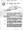
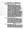
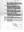
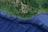

# William James Mackay
(After 1920 - ?)

## Immediate Family

* Partner: X
* Father: [Thomas Mackay](./@5045152@-thomas-mackay-b1882-6-27-d1934-11-9.md) (27/Jun/1882 - 9/Nov/1934)
* Mother: [Lucy Mackay](./@16587624@-lucy-mackay-b1889-9-23-d1970-5-15.md) (23/Sep/1889 - 15/May/1970)
* Brother: [Thomas Mackay](./@11442358@-thomas-mackay-b1920-d.md) (after 1920 - )
* Brother: [Kenneth Mackay](./@52754046@-kenneth-mackay-b1920-3-28-d.md) (28/Mar/1920 - )

## Timeline

Date | Item | Description | Sources | Notes
---|---|---|---|---
after 1920 | Born | Born to [Thomas Mackay](./@5045152@-thomas-mackay-b1882-6-27-d1934-11-9.md) and [Lucy Mackay](./@16587624@-lucy-mackay-b1889-9-23-d1970-5-15.md). |  | 
after 1920 | Birth of brother | [Thomas Mackay](./@11442358@-thomas-mackay-b1920-d.md) born to [Thomas Mackay](./@5045152@-thomas-mackay-b1882-6-27-d1934-11-9.md) and [Lucy Mackay](./@16587624@-lucy-mackay-b1889-9-23-d1970-5-15.md). |  | 
28/Mar/1920 | Birth of brother | [Kenneth Mackay](./@52754046@-kenneth-mackay-b1920-3-28-d.md) born to [Thomas Mackay](./@5045152@-thomas-mackay-b1882-6-27-d1934-11-9.md) and [Lucy Mackay](./@16587624@-lucy-mackay-b1889-9-23-d1970-5-15.md) in Embo, Sutherland, Scotland. | [1](#1) | 
9/Nov/1934 | Death of father | [Thomas Mackay](./@5045152@-thomas-mackay-b1882-6-27-d1934-11-9.md) died in North Pacific Ocean off the coast of Mexico, . | [2](#2), [3](#3), [4](#4) | 
15/May/1970 | Death of mother | [Lucy Mackay](./@16587624@-lucy-mackay-b1889-9-23-d1970-5-15.md) died in Inverness, Scotland. | [5](#5) | 

## Footnotes

### 1

**1920 MACKAY, KENNETH (Statutory Registers Births 047/19)**

* [Full text and notes](../sources/@37222698@-1920-mackay,-kenneth-statutory-registers-births-047-19-.md)
* Date: 3/Apr/1920
* Responsible Agency: National Records of Scotland
* References: 
  * 1920 B 047/19

### 2

**1934 MACKAY, THOMAS (The Donaldson Line Limited - SS Gregalia)**

* [Full text and notes](../sources/@31684368@-1934-mackay,-thomas-the-donaldson-line-limited-ss-gregalia-.md)
* Date: 10/Nov/1934
*    

### 3

**1934 MCKAY, THOMAS (Statutory Register Deaths 030/MR 342)**

* [Full text and notes](../sources/@21891484@-1934-mckay,-thomas-statutory-register-deaths-030-mr-342-.md)
* Responsible Agency: National Records of Scotland
* References: 
  * 1934 D 030/MR 342

### 4

**MACKAY, THOMAS (Photo - S.S. Gregalia)**

* [Full text and notes](../sources/@66111707@-mackay,-thomas-photo-s.s.-gregalia-.md)
* References: 
  * (URL) https://www.familysearch.org/memories/memory/48623574

### 5

**1970 MACKAY, LUCY (Statutory Register Deaths)**

* [Full text and notes](../sources/@94309804@-1970-mackay,-lucy-statutory-register-deaths-.md)
* Date: 15/May/1970
* Responsible Agency: National Records of Scotland
* References: 
  * 1970 D 98/A 269

