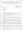
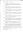

# William Mackay
(BET 1843 AND 1846 - ?)

## Immediate Family

* Father: [George Mackay](./@33764614@-george-mackay-b1811-10-26-d1893-11-25.md) (26/Oct/1811 - 25/Nov/1893)
* Mother: [Lucy Matheson](./@67811996@-lucy-matheson-b1813~1820-d1896-8-23.md) (bet' 1813 and 1820 - 23/Aug/1896)
* Sister: [Janet Mackay](./@42213240@-janet-mackay-b1840-d.md) (1840 - )
* Brother: [John Mackay](./@58430005@-john-mackay-b1841-2-18-d.md) (18/Feb/1841 - )
* Brother: [Alexander Mackay](./@2381836@-alexander-mackay-b1844~1849-d.md) (bet' 1844 and 1849 - )
* Brother: [David Mackay](./@46263680@-david-mackay-b1846-d1860.md) (1846 - 1860)
* Sister: [Barbara Mackay](./@52409786@-barbara-mackay-b1849~1854-d.md) (bet' 1849 and 1854 - )
* Sister: [Catherine Mackay](./@26872816@-catherine-mackay-b1849~1856-d.md) (bet' 1849 and 1856 - )
* Wife: [Cate Grant](./@89641618@-cate-grant-b1849~1851-d.md) (bet' 1849 and 1851 - )
* Brother: [Donald Mackay](./@32633938@-donald-mackay-b1855-d.md) (about 1855 - )
* Sister: [Ann Mackay](./@74868546@-ann-mackay-b1855-11-5-d1940-4-21.md) (5/Nov/1855 - 21/Apr/1940)
* Sister: [Jane or Jean Mackay](./@4172390@-jane-or-jean-mackay-b1859-d.md) (about 1859 - )
* Brother: [James Mackay](./@60572122@-james-mackay-b1861-4-12-d1903-7-6.md) (12/Apr/1861 - 6/Jul/1903)

## Timeline

Date | Item | Description | Sources | Notes
---|---|---|---|---
bet' 1843 and 1846 | Born | Born to [George Mackay](./@33764614@-george-mackay-b1811-10-26-d1893-11-25.md) and [Lucy Matheson](./@67811996@-lucy-matheson-b1813~1820-d1896-8-23.md). | [1](#1), [2](#2), [3](#3) | [4](#4)
bet' 1844 and 1849 | Birth of brother | [Alexander Mackay](./@2381836@-alexander-mackay-b1844~1849-d.md) born to [George Mackay](./@33764614@-george-mackay-b1811-10-26-d1893-11-25.md) and [Lucy Matheson](./@67811996@-lucy-matheson-b1813~1820-d1896-8-23.md). | [1](#1), [2](#2), [3](#3) | [5](#5)
1846 | Birth of brother | [David Mackay](./@46263680@-david-mackay-b1846-d1860.md) born to [George Mackay](./@33764614@-george-mackay-b1811-10-26-d1893-11-25.md) and [Lucy Matheson](./@67811996@-lucy-matheson-b1813~1820-d1896-8-23.md). | [1](#1), [3](#3) | 
bet' 1849 and 1854 | Birth of sister | [Barbara Mackay](./@52409786@-barbara-mackay-b1849~1854-d.md) born to [George Mackay](./@33764614@-george-mackay-b1811-10-26-d1893-11-25.md) and [Lucy Matheson](./@67811996@-lucy-matheson-b1813~1820-d1896-8-23.md). | [2](#2), [3](#3) | [6](#6)
bet' 1849 and 1856 | Birth of sister | [Catherine Mackay](./@26872816@-catherine-mackay-b1849~1856-d.md) born to [George Mackay](./@33764614@-george-mackay-b1811-10-26-d1893-11-25.md) and [Lucy Matheson](./@67811996@-lucy-matheson-b1813~1820-d1896-8-23.md). | [2](#2), [3](#3) | [7](#7)
about 1855 | Birth of brother | [Donald Mackay](./@32633938@-donald-mackay-b1855-d.md) born to [George Mackay](./@33764614@-george-mackay-b1811-10-26-d1893-11-25.md) and [Lucy Matheson](./@67811996@-lucy-matheson-b1813~1820-d1896-8-23.md). | [2](#2), [3](#3) | 
5/Nov/1855 | Birth of sister | [Ann Mackay](./@74868546@-ann-mackay-b1855-11-5-d1940-4-21.md) born to [George Mackay](./@33764614@-george-mackay-b1811-10-26-d1893-11-25.md) and [Lucy Matheson](./@67811996@-lucy-matheson-b1813~1820-d1896-8-23.md) in Embo, Sutherland, Scotland. | [2](#2), [3](#3), [8](#8), [9](#9) | [10](#10)
about 1859 | Birth of sister | [Jane or Jean Mackay](./@4172390@-jane-or-jean-mackay-b1859-d.md) born to [George Mackay](./@33764614@-george-mackay-b1811-10-26-d1893-11-25.md) and [Lucy Matheson](./@67811996@-lucy-matheson-b1813~1820-d1896-8-23.md). | [2](#2), [3](#3), [11](#11) | [12](#12)
1860 | Death of brother | [David Mackay](./@46263680@-david-mackay-b1846-d1860.md) died. | [3](#3) | 
12/Apr/1861 | Birth of brother | [James Mackay](./@60572122@-james-mackay-b1861-4-12-d1903-7-6.md) born to [George Mackay](./@33764614@-george-mackay-b1811-10-26-d1893-11-25.md) and [Lucy Matheson](./@67811996@-lucy-matheson-b1813~1820-d1896-8-23.md) in Embo, Sutherland, Scotland. | [2](#2), [3](#3), [13](#13), [14](#14), [15](#15) | 
7/Nov/1876 | Marriage | Married to [Cate Grant](./@89641618@-cate-grant-b1849~1851-d.md) in Dornoch, Sutherland, Scotland | [2](#2), [3](#3) | 
25/Nov/1893 | Death of father | [George Mackay](./@33764614@-george-mackay-b1811-10-26-d1893-11-25.md) died in Embo, Sutherland, Scotland. | [2](#2), [16](#16) | 
23/Aug/1896 | Death of mother | [Lucy Matheson](./@67811996@-lucy-matheson-b1813~1820-d1896-8-23.md) died in Embo, Sutherland, Scotland. | [2](#2), [17](#17) | 
6/Jul/1903 | Death of brother | [James Mackay](./@60572122@-james-mackay-b1861-4-12-d1903-7-6.md) died. | [18](#18) | 
21/Apr/1940 | Death of sister | [Ann Mackay](./@74868546@-ann-mackay-b1855-11-5-d1940-4-21.md) died. | [19](#19), [20](#20) | 

## Known Residences

Date | Residence | Sources & Notes
---|---|---
1851 | Embo, Sutherland, Scotland | [1](#1)
1871 | Embo, Sutherland, Scotland | [21](#21)
1876 | Embo, Sutherland, Scotland | [2](#2)

## Known Occupations

Date | Occupation | Sources & Notes
---|---|---
1871 | Fisherman | [21](#21)
1876 | Fisherman | [2](#2)

## Notes

> Rona Grigg 2016 Ref F9.2.3
>

## Footnotes

### 1

**1951 MACKAY, GEORGE & HOUSEHOLD (Census 1851 047/ 5/ 11)**

* [Full text and notes](../sources/@77150351@-1951-mackay,-george-&-household-census-1851-047-5-11-.md)
* Date: 1851
* Responsible Agency: National Registers of Scotland
* References: 
  * 1851 C 047/ 5/ 11

### 2

**1984 TULLOCH, BARRIE M - Letter from Registrar in Brora**

* [Full text and notes](../sources/@94133243@-1984-tulloch,-barrie-m-letter-from-registrar-in-brora.md)
* Originator / Author: John MacLennan
* Date: 19/Jul/1984
* Responsible Agency: Highland Regional Council
*  

### 3

**P113 Embo - genealogy, Uncle Sandy's Story and a little history**

* [Full text and notes](../sources/@17489530@-p113-embo-genealogy,-uncle-sandy's-story-and-a-little-history.md)
* Publication: Embo - genealogy, Uncle Sandy's Story and a little history
* Originator / Author: Catriona Grigg
* Date: 2016
* Filed by Entry: EMBO/P113/F9.2
* References: 
  * (ISBN) 978-1-910205-49-5

### 4

> EMBO/P113 suggests DoB of about 1843
>
> Letter to B.M.Tulloch says married at 30 on 7/Nov/1876 so birth is between 8/Nov/1845 and 9/Nov/1846
>
> 1851 census says 8 years old, so 1843
>

### 5

> EMBO/P113/F9.2.4 says birth about 1844
>
> Letter to B.M.Tulloch says married at 28 on 23/Oct/1877, so puts birth at 1848/9
>
> 1851 Census says 7 years old, so 1844
>

### 6

> Two differing suggestions
>
>  
>
> EMBO says 1854
>
> Letter to B.M.Tulloch says 19 years back from marriage in 1869 which would put birth between 17/Nov/1849 and 16/Nov/1850
>
> Does not appear on the 1851 census.
>
> Does appear on the 1861 census, but aged 7.
>

### 7

> Conflicting dates of birth.
>
> EMBO suggests 1849
>
> Letter to B.M.Tulloch suggests between 22/Oct/1855 to 21/Oct/1856 (Marriage at 17 on 21/Oct/1873)
>
> Appears on the 1851 census, as a 6 year old, but as a 9 year old on the 1861 census. Perhaps two people, a child that died and a second child where that had the same name?
>

### 8

**1855 MACKAY, ANN (Statutory Register of Births 047/2 44)**

* [Full text and notes](../sources/@9162976@-1855-mackay,-ann-statutory-register-of-births-047-2-44-.md)
* Date: 7/Nov/1855
* Responsible Agency: National Records of Scotland
* References: 
  * 1855 B 047/2 44

### 9

**2020 CUMMING, ADAM 1/3 Descendant Report**

* [Full text and notes](../sources/@96911480@-2020-cumming,-adam-1-3-descendant-report.md)
* Originator / Author: Helen McDermott
* Date: 13/Jan/2020

### 10

> There are some conflicts between sources on the date of birth. Going with the most precise, which is also from a registrar - so assuming also the most accurate.
>

### 11

**1861 MACKAY, GEORGE & HOUSEHOLD (Census 047/ 1/ 15)**

* [Full text and notes](../sources/@33557678@-1861-mackay,-george-&-household-census-047-1-15-.md)
* Date: 1861
* Responsible Agency: National Registers of Scotland
* References: 
  * 1861 C 047/ 1/ 15

### 12

> EMBO/P113/F9.2.10 suggests DoB about 1859
>
> Letter to TULLOCH says married on 24/Mar/1892 at 29, which puts birth between 25/Mar/1862 and 24/Mar/1863
>
> Appears on the 1861 census as a 2 year old.
>

### 13

**1861 MACKAY, JAMES - Statutory Register Births**

* [Full text and notes](../sources/@91936123@-1861-mackay,-james-statutory-register-births.md)
* Publication: Statutory Register Births
* Date: 15/Apr/1861
* Responsible Agency: National Records of Scotland
* References: 
  * 1861 B 047/25

### 14

**1861 MACKAY, JAMES (Scotland Births and Baptisms, 1564-1950)**

* [Full text and notes](../sources/@81027024@-1861-mackay,-james-scotland-births-and-baptisms,-1564-1950-.md)
* Publication: Scotland Births and Baptisms, 1564-1950
* Responsible Agency: FamilySearch
* References: 
  * (URL) https://www.familysearch.org/ark:/61903/1:1:FQRF-PL4

### 15

**P116 Embo - genealogy, Uncle Sandy's Story and a little history**

* [Full text and notes](../sources/@26144122@-p116-embo-genealogy,-uncle-sandy's-story-and-a-little-history.md)
* Publication: Embo - genealogy, Uncle Sandy's Story and a little history
* Originator / Author: Catriona Grigg
* Date: 2016
* Filed by Entry: EMBO/P116/F9.2.11
* References: 
  * (ISBN) 978-1-910205-49-5

### 16

**1893 MACKAY, GEORGE (Statutory Register of Deaths 047/ 36)**

* [Full text and notes](../sources/@49049588@-1893-mackay,-george-statutory-register-of-deaths-047-36-.md)
* Date: 27/Nov/1893
* Responsible Agency: National Records of Scotland
* References: 
  * 1893 D 047/ 36

### 17

**1896 MACKAY, LUCY (Statutory Register of Deaths 047/ 25)**

* [Full text and notes](../sources/@78326520@-1896-mackay,-lucy-statutory-register-of-deaths-047-25-.md)
* Date: 24/Aug/1896
* Responsible Agency: National Records of Scotland
* References: 
  * 1896 D 047/ 25

### 18

**1903 MACKAY, JAMES (Statutory Register of Deaths 047/ 24)**

* [Full text and notes](../sources/@53286704@-1903-mackay,-james-statutory-register-of-deaths-047-24-.md)
* Date: 7/Jul/1903
* Responsible Agency: National Records of Scotland
* References: 
  * 1903 D 047/ 24

### 19

**1940 CUMMING, ANNIE (Statutory Register of Deaths, 047/ 18)**

* [Full text and notes](../sources/@31629256@-1940-cumming,-annie-statutory-register-of-deaths,-047-18-.md)
* Date: 22/Apr/1940
* Responsible Agency: National Records of Scotland
* References: 
  * 1940 D 047/ 18

### 20

**CUMMING, DONALD, CATHERINE, ADAM, JAMES, ANN (Find a grave - Memorial 195215019)**

* [Full text and notes](../sources/@34502004@-cumming,-donald,-catherine,-adam,-james,-ann-find-a-grave-memorial-195215019-.md)
* Publication: FindAGrave.com
* Date: 7/Dec/2018
* References: 
  * (URL) https://www.findagrave.com/memorial/195215019/adam-cumming

### 21

**1871 MACKAY, GEORGE & HOUSEHOLD (Census 047/ 1/L 12)**

* [Full text and notes](../sources/@13396232@-1871-mackay,-george-&-household-census-047-1-l-12-.md)
* Date: 1871
* Responsible Agency: National Records of Scotland
* References: 
  * 1871 C 047/ 1/L 12

